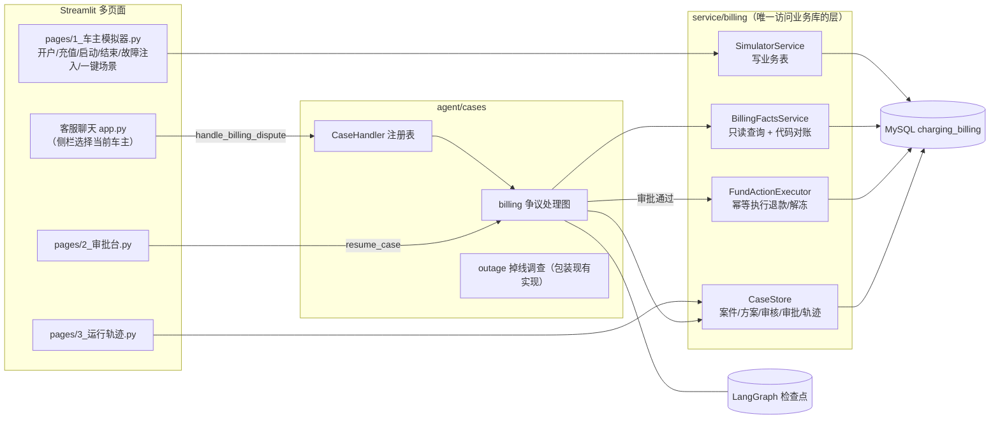
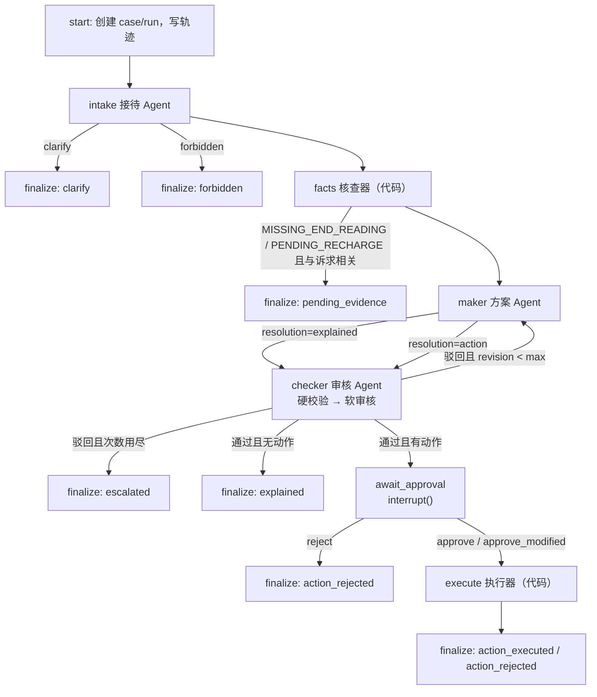

# 充电费用争议处理 · Maker-Checker 多 Agent 开发文档（v2）

> 本文档用于交给开发智能体实施。请按「第十二节 开发阶段与验收」逐阶段完成，每阶段结束时保证全部测试通过再进入下一阶段。

## 0 背景与目标

面向充电运营平台的客服与二线支持。车主反馈「扫了两次，第一次失败，余额少了一大块」「这单怎么按高峰价算了」「我没超时为什么收占位费」时，系统：

1. **接待 Agent** 澄清诉求并定位订单；
2. **核查器（代码）** 对齐启动尝试、充电会话、电表读数、订单与钱包流水，按计费政策重算应付；
3. **方案 Agent（maker）** 起草处理方案（解释 / 退款 / 解冻 / 待补证据）；
4. **审核 Agent（checker）** 独立回查证据并复核，不通过则打回修订；
5. **人工审批** 后由 **资金执行器（代码）** 幂等执行。

配套 **Streamlit 模拟运营台**：在页面上开户、充值、扫码启动、充电、结束，并可注入故障，用于制造争议、人工验收与演示。

**支付方式只有钱包**：充值 → 启动时冻结 → 结束时结算扣款并解冻 → 退款退回钱包余额。

**数据库使用 MySQL**（复用 `config/db.yml` 的连接信息，独立数据库名）。

一句话定位：**用「制单与复核分离 + 最小权限 + 人工审批」的多 Agent 协作处理涉及资金的客服请求，并用对照实验证明独立复核能拦截错误的资金操作；框架可扩展，新的争议类型、资金动作、Agent 角色都以注册方式接入。**

---

## 1 为什么是多 Agent

| 诉求 | 设计 | 单 Agent 的问题 |
| - | - | - |
| 起草人不能自己批准 | 方案 Agent 与审核 Agent 分离；审核方看不到方案方的推理过程和对话历史，只拿到方案本身，并自己调工具回查 | 自己起草、自己检查，容易沿用同一个错误前提（锚定） |
| 最小权限 | 各 Agent 的工具白名单不同；**没有任何 LLM 持有写库工具**；执行器是代码 | 一个 Agent 同时持有查询和退款工具，提示词注入即可越权 |
| 资金动作需人工兜底 | 审核通过后 LangGraph `interrupt` 挂起，审批台恢复 | 在单个 ReAct 循环中难以挂起并跨进程恢复 |
| 结论可追溯 | 方案中的每个结论和金额都引用证据 ID，审核按 ID 回查 | — |

**LLM 与代码的边界（必须遵守）**：

- 用 LLM：理解诉求、澄清追问、选择与诉求相关的异常、解读计费政策、组织方案、生成车主说明、软性审核。
- 不用 LLM：数据关联、金额与电量计算、可退额度、硬性审核规则、资金执行。

---

## 2 系统总览



约束：

- 页面、评测脚本、Agent 工具都**只调用服务层**，不直接写 SQL。
- 只有 `SimulatorService`（模拟业务系统）和 `FundActionExecutor`（审批后的资金动作）可以写业务表。
- 车主身份由服务端注入（聊天侧栏选择 → runtime context → 工具），**LLM 不能通过参数指定 customer_id**。

---

## 3 目录与文件

```
config/
  billing.example.yml          # 新增，提交
  billing.yml                  # 新增，本地，加入 .gitignore
service/billing/
  __init__.py
  db.py                        # 引擎、建库、执行 schema
  schema.sql                   # 第五节 DDL
  errors.py                    # 统一异常与错误码
  models.py                    # Pydantic DTO（第六节）
  ids.py                       # ID 生成
  timeutil.py                  # UTC/本地时区转换
  tariff.py                    # 纯函数：计费、占位费、时段判断
  simulator_service.py
  scenarios.py                 # 一键场景（页面与评测共用）
  facts_service.py
  executor.py
  case_store.py
agent/cases/
  __init__.py
  base.py                      # CaseHandler 协议、CaseResult
  registry.py                  # 处理器注册表
  agent_spec.py                # AgentSpec + 构建 LLM/离线节点
  fund_actions.py              # 资金动作注册表（refund/unfreeze）
  billing/
    __init__.py
    state.py
    graph.py
    intake.py
    maker.py
    checker.py                 # hard_checks + soft_review
    offline.py                 # 三个 LLM 角色的离线规则实现
    tools.py                   # Agent 内部只读工具（按角色白名单）
    handler.py                 # BillingDisputeHandler
  outage/
    handler.py                 # 包装现有 investigate_outage 能力
agent/tools/case_tools.py      # 聊天主 Agent 使用的工具
prompts/billing_intake.txt
prompts/billing_maker.txt
prompts/billing_checker.txt
pages/1_车主模拟器.py
pages/2_审批台.py
pages/3_运行轨迹.py
scripts/init_billing_db.py
eval/billing/
  cases.json                   # 11 个场景的期望（符号化引用 ID）
  mutations.py                 # 方案错误注入
  run_evaluation.py
  compare_designs.py           # A/B/C 对照
tests/
  test_billing_tariff.py       # 纯函数，无需 MySQL
  test_billing_services.py     # 需要 MySQL，未配置则 skip
  test_billing_executor.py     # 需要 MySQL
  test_billing_graph.py        # 离线模式 + InMemorySaver
  test_billing_chat_tool.py
```

---

## 4 配置

`config/billing.example.yml`：

```yaml
mysql_database: charging_billing      # 复用 db.yml 的 host/port/user/password/charset
local_timezone: Asia/Shanghai         # 计费时段按本地时间判断；库内时间一律存 UTC
planner: offline                      # offline | deepseek
max_revisions: 2                      # 审核驳回后方案最多修订次数
maker_max_tool_calls: 3
checker_max_tool_calls: 4
checkpoint_sqlite_path: data/checkpoints/billing_cases.sqlite
default_operator: ops-admin           # 审批台默认审批人
```

- 在 `utils/config_handler.py` 中新增 `load_billing_config()` 与 `billing_conf`：优先读 `config/billing.yml`，文件不存在时回退读 `config/billing.example.yml`，避免无本地配置时导入失败。
- `.gitignore` 增加 `config/billing.yml` 与 `data/checkpoints/`。
- 不修改现有 `utils/db_handler.py` 的行为（它在导入时就会创建引擎）。新建 `service/billing/db.py`，复用其中的 `build_mysql_url` 拼接思路，但数据库名取自 `billing_conf`，并允许参数覆盖（评测使用临时库）。

`service/billing/db.py` 接口：

```python
def build_billing_url(database: str | None = None, *, server_only: bool = False) -> str: ...
@cache
def get_billing_engine(database: str | None = None) -> Engine: ...       # pool_pre_ping=True, pool_recycle=3600
def create_database(name: str) -> None: ...                               # CREATE DATABASE IF NOT EXISTS ... utf8mb4
def drop_database(name: str) -> None: ...                                 # 仅允许名称以 cb_eval_ / cb_test_ 开头
def apply_schema(engine: Engine) -> None: ...                             # 执行 schema.sql（幂等）
def reset_business_data(engine: Engine) -> None: ...                      # 清空业务与案件表，保留并重灌种子数据
```

`scripts/init_billing_db.py`：`python -m scripts.init_billing_db [--database NAME] [--reset]`，建库、建表、写入种子数据（第 5.4 节）。重复执行不报错。

---

## 5 数据库设计（MySQL 8，InnoDB，utf8mb4）

通用约定：

- 金额一律 `BIGINT`，单位**分**；电量 `BIGINT`，单位 **Wh**；单价单位 **分/kWh**。代码中禁止使用 float 计算金额。
- 时间一律 `DATETIME(3)`，存 **UTC**（无时区的 naive 值），由 `timeutil.py` 统一转换。
- ID 为带前缀的字符串：`CUS-`、`ATT-`、`SES-`、`MTR-`、`ORD-`、`TXN-`、`CASE-`、`RUN-`、`PRP-`、`REV-`、`APV-`、`ACT-`，后接 12 位大写十六进制（`ids.new_id(prefix)`）。
- 表名统一前缀 `cb_`。

### 5.1 业务表

```sql
CREATE TABLE IF NOT EXISTS cb_customers (
  customer_id   VARCHAR(32)  NOT NULL PRIMARY KEY,
  nickname      VARCHAR(64)  NOT NULL,
  created_at    DATETIME(3)  NOT NULL
) ENGINE=InnoDB DEFAULT CHARSET=utf8mb4;

-- 钱包投影：以流水为准，本表在同一事务中随流水更新，用于快速展示与加锁
CREATE TABLE IF NOT EXISTS cb_wallets (
  customer_id   VARCHAR(32)  NOT NULL PRIMARY KEY,
  balance_fen   BIGINT       NOT NULL DEFAULT 0,   -- 账面余额（含冻结部分）
  frozen_fen    BIGINT       NOT NULL DEFAULT 0,   -- 冻结中金额；可用余额 = balance - frozen
  version       INT          NOT NULL DEFAULT 0,
  updated_at    DATETIME(3)  NOT NULL,
  CONSTRAINT fk_wallet_customer FOREIGN KEY (customer_id) REFERENCES cb_customers(customer_id),
  CONSTRAINT chk_wallet_nonneg CHECK (balance_fen >= 0 AND frozen_fen >= 0)
) ENGINE=InnoDB DEFAULT CHARSET=utf8mb4;

CREATE TABLE IF NOT EXISTS cb_tariff_policies (
  policy_id               VARCHAR(32)  NOT NULL PRIMARY KEY,
  name                    VARCHAR(64)  NOT NULL,
  effective_from          DATETIME(3)  NOT NULL,
  effective_to            DATETIME(3)  NULL,          -- NULL 表示长期有效
  idle_grace_minutes      INT          NOT NULL,
  idle_fee_fen_per_minute INT          NOT NULL,
  idle_fee_cap_fen        INT          NULL,
  freeze_amount_fen       INT          NOT NULL,
  policy_text             TEXT         NOT NULL       -- 给车主/Agent 阅读的计费规则原文
) ENGINE=InnoDB DEFAULT CHARSET=utf8mb4;

CREATE TABLE IF NOT EXISTS cb_tariff_periods (
  policy_id               VARCHAR(32)  NOT NULL,
  start_local             TIME         NOT NULL,      -- 本地时间，含
  end_local               TIME         NOT NULL,      -- 本地时间，不含；end <= start 表示跨零点
  period_type             ENUM('peak','flat','valley') NOT NULL,
  electricity_fen_per_kwh INT          NOT NULL,
  service_fen_per_kwh     INT          NOT NULL,
  PRIMARY KEY (policy_id, start_local),
  CONSTRAINT fk_period_policy FOREIGN KEY (policy_id) REFERENCES cb_tariff_policies(policy_id)
) ENGINE=InnoDB DEFAULT CHARSET=utf8mb4;

CREATE TABLE IF NOT EXISTS cb_chargers (
  charger_id    VARCHAR(32)  NOT NULL,
  connector_id  VARCHAR(8)   NOT NULL,
  station_name  VARCHAR(64)  NOT NULL,
  policy_id     VARCHAR(32)  NOT NULL,
  PRIMARY KEY (charger_id, connector_id),
  CONSTRAINT fk_charger_policy FOREIGN KEY (policy_id) REFERENCES cb_tariff_policies(policy_id)
) ENGINE=InnoDB DEFAULT CHARSET=utf8mb4;

CREATE TABLE IF NOT EXISTS cb_charging_attempts (
  attempt_id     VARCHAR(32)  NOT NULL PRIMARY KEY,
  customer_id    VARCHAR(32)  NOT NULL,
  charger_id     VARCHAR(32)  NOT NULL,
  connector_id   VARCHAR(8)   NOT NULL,
  requested_at   DATETIME(3)  NOT NULL,
  result         ENUM('started','timeout','rejected') NOT NULL,
  session_id     VARCHAR(32)  NULL,
  freeze_txn_id  VARCHAR(32)  NULL,
  INDEX idx_attempt_customer (customer_id, requested_at),
  INDEX idx_attempt_charger (charger_id, connector_id, requested_at),
  CONSTRAINT fk_attempt_customer FOREIGN KEY (customer_id) REFERENCES cb_customers(customer_id)
) ENGINE=InnoDB DEFAULT CHARSET=utf8mb4;

CREATE TABLE IF NOT EXISTS cb_charging_sessions (
  session_id     VARCHAR(32)  NOT NULL PRIMARY KEY,
  attempt_id     VARCHAR(32)  NOT NULL UNIQUE,
  charger_id     VARCHAR(32)  NOT NULL,
  connector_id   VARCHAR(8)   NOT NULL,
  started_at     DATETIME(3)  NOT NULL,
  charge_end_at  DATETIME(3)  NULL,       -- 停止充电时间
  unplugged_at   DATETIME(3)  NULL,       -- 拔枪时间（占位费依据）
  status         ENUM('charging','finished') NOT NULL,
  CONSTRAINT fk_session_attempt FOREIGN KEY (attempt_id) REFERENCES cb_charging_attempts(attempt_id)
) ENGINE=InnoDB DEFAULT CHARSET=utf8mb4;

CREATE TABLE IF NOT EXISTS cb_meter_readings (
  reading_id     VARCHAR(32)  NOT NULL PRIMARY KEY,
  session_id     VARCHAR(32)  NOT NULL,
  reading_type   ENUM('start','end') NOT NULL,
  energy_wh      BIGINT       NOT NULL,
  occurred_at    DATETIME(3)  NOT NULL,
  received_at    DATETIME(3)  NOT NULL,   -- 补传时 received_at 晚于 occurred_at
  UNIQUE KEY uk_session_reading (session_id, reading_type),
  CONSTRAINT fk_reading_session FOREIGN KEY (session_id) REFERENCES cb_charging_sessions(session_id)
) ENGINE=InnoDB DEFAULT CHARSET=utf8mb4;

CREATE TABLE IF NOT EXISTS cb_orders (
  order_id            VARCHAR(32)  NOT NULL PRIMARY KEY,
  customer_id         VARCHAR(32)  NOT NULL,
  attempt_id          VARCHAR(32)  NOT NULL,
  session_id          VARCHAR(32)  NOT NULL UNIQUE,
  policy_id           VARCHAR(32)  NOT NULL,     -- 下单时的政策快照
  energy_wh           BIGINT       NULL,         -- 缺结束读数时为 NULL
  electricity_fee_fen BIGINT       NULL,
  service_fee_fen     BIGINT       NULL,
  idle_fee_fen        BIGINT       NULL,
  total_fen           BIGINT       NULL,         -- 订单应付快照（可能被故障注入写错）
  status              ENUM('pending_settlement','settled') NOT NULL,
  created_at          DATETIME(3)  NOT NULL,
  settled_at          DATETIME(3)  NULL,
  INDEX idx_order_customer (customer_id, created_at),
  CONSTRAINT fk_order_customer FOREIGN KEY (customer_id) REFERENCES cb_customers(customer_id),
  CONSTRAINT fk_order_session FOREIGN KEY (session_id) REFERENCES cb_charging_sessions(session_id)
) ENGINE=InnoDB DEFAULT CHARSET=utf8mb4;

-- 钱包流水：资金事实的唯一来源
CREATE TABLE IF NOT EXISTS cb_wallet_transactions (
  txn_id           VARCHAR(32)  NOT NULL PRIMARY KEY,
  customer_id      VARCHAR(32)  NOT NULL,
  txn_type         ENUM('recharge','freeze','unfreeze','deduct','refund') NOT NULL,
  status           ENUM('pending','succeeded','failed') NOT NULL,
  amount_fen       BIGINT       NOT NULL,
  order_id         VARCHAR(32)  NULL,
  attempt_id       VARCHAR(32)  NULL,
  related_txn_id   VARCHAR(32)  NULL,     -- unfreeze→freeze，refund→deduct
  external_txn_no  VARCHAR(64)  NULL,     -- 充值渠道单号
  idempotency_key  VARCHAR(96)  NULL,
  source           ENUM('simulator','ops_manual','fund_executor') NOT NULL,
  note             VARCHAR(255) NULL,
  created_at       DATETIME(3)  NOT NULL,
  finished_at      DATETIME(3)  NULL,
  UNIQUE KEY uk_external_txn (external_txn_no),
  UNIQUE KEY uk_idempotency (idempotency_key),
  INDEX idx_txn_customer (customer_id, created_at),
  INDEX idx_txn_order (order_id),
  INDEX idx_txn_related (related_txn_id),
  CONSTRAINT chk_txn_amount CHECK (amount_fen > 0),
  CONSTRAINT fk_txn_customer FOREIGN KEY (customer_id) REFERENCES cb_customers(customer_id)
) ENGINE=InnoDB DEFAULT CHARSET=utf8mb4;
```

钱包流水对投影的影响（仅 `succeeded` 生效）：

| txn_type | balance_fen | frozen_fen |
| - | - | - |
| recharge | +amount | 0 |
| freeze | 0 | +amount |
| unfreeze | 0 | −amount |
| deduct | −amount | 0 |
| refund | +amount | 0 |

### 5.2 案件与 Agent 运行表

```sql
CREATE TABLE IF NOT EXISTS cb_dispute_cases (
  case_id          VARCHAR(32)  NOT NULL PRIMARY KEY,
  handler          VARCHAR(32)  NOT NULL,          -- 'billing_dispute'，预留其他处理器
  customer_id      VARCHAR(32)  NOT NULL,
  chat_session_id  VARCHAR(64)  NULL,
  question         TEXT         NOT NULL,
  dispute_type     VARCHAR(32)  NULL,
  status           VARCHAR(32)  NOT NULL,          -- 取值见 6.6 报告状态
  latest_run_id    VARCHAR(32)  NULL,
  created_at       DATETIME(3)  NOT NULL,
  updated_at       DATETIME(3)  NOT NULL,
  INDEX idx_case_customer (customer_id, created_at),
  INDEX idx_case_status (status)
) ENGINE=InnoDB DEFAULT CHARSET=utf8mb4;

CREATE TABLE IF NOT EXISTS cb_case_runs (
  run_id       VARCHAR(32)  NOT NULL PRIMARY KEY,  -- 同时作为 LangGraph thread_id
  case_id      VARCHAR(32)  NOT NULL,
  planner      ENUM('offline','deepseek') NOT NULL,
  status       VARCHAR(32)  NOT NULL,
  report       JSON         NULL,
  started_at   DATETIME(3)  NOT NULL,
  finished_at  DATETIME(3)  NULL,
  INDEX idx_run_case (case_id),
  CONSTRAINT fk_run_case FOREIGN KEY (case_id) REFERENCES cb_dispute_cases(case_id)
) ENGINE=InnoDB DEFAULT CHARSET=utf8mb4;

CREATE TABLE IF NOT EXISTS cb_proposals (
  proposal_id  VARCHAR(32)  NOT NULL PRIMARY KEY,
  run_id       VARCHAR(32)  NOT NULL,
  version      INT          NOT NULL,
  payload      JSON         NOT NULL,              -- Proposal 序列化
  created_at   DATETIME(3)  NOT NULL,
  UNIQUE KEY uk_run_version (run_id, version)
) ENGINE=InnoDB DEFAULT CHARSET=utf8mb4;

CREATE TABLE IF NOT EXISTS cb_reviews (
  review_id          VARCHAR(32)  NOT NULL PRIMARY KEY,
  proposal_id        VARCHAR(32)  NOT NULL,
  hard_check_passed  BOOLEAN      NOT NULL,
  approved           BOOLEAN      NOT NULL,
  issues             JSON         NOT NULL,
  created_at         DATETIME(3)  NOT NULL,
  INDEX idx_review_proposal (proposal_id)
) ENGINE=InnoDB DEFAULT CHARSET=utf8mb4;

CREATE TABLE IF NOT EXISTS cb_approvals (
  approval_id      VARCHAR(32)  NOT NULL PRIMARY KEY,
  proposal_id      VARCHAR(32)  NOT NULL UNIQUE,
  approver         VARCHAR(64)  NOT NULL,
  decision         ENUM('approve','reject','approve_modified') NOT NULL,
  modified_actions JSON         NULL,             -- approve_modified 时的最终动作
  comment          VARCHAR(255) NULL,
  decided_at       DATETIME(3)  NOT NULL
) ENGINE=InnoDB DEFAULT CHARSET=utf8mb4;

CREATE TABLE IF NOT EXISTS cb_fund_actions (
  action_id        VARCHAR(32)  NOT NULL PRIMARY KEY,
  proposal_id      VARCHAR(32)  NOT NULL,
  action_index     INT          NOT NULL,
  action_type      VARCHAR(32)  NOT NULL,         -- 'refund' | 'unfreeze'，可扩展
  idempotency_key  VARCHAR(96)  NOT NULL UNIQUE,
  target_txn_id    VARCHAR(32)  NOT NULL,
  amount_fen       BIGINT       NOT NULL,
  result_txn_id    VARCHAR(32)  NULL,
  status           ENUM('succeeded','rejected') NOT NULL,
  reject_reason    VARCHAR(255) NULL,
  created_at       DATETIME(3)  NOT NULL
) ENGINE=InnoDB DEFAULT CHARSET=utf8mb4;

CREATE TABLE IF NOT EXISTS cb_trace_events (
  id          BIGINT       NOT NULL AUTO_INCREMENT PRIMARY KEY,
  run_id      VARCHAR(32)  NOT NULL,
  seq         INT          NOT NULL,
  node        VARCHAR(64)  NOT NULL,
  event_type  VARCHAR(32)  NOT NULL,    -- node_start / node_end / tool_call / llm_output / interrupt / resume / error
  payload     JSON         NOT NULL,
  created_at  DATETIME(3)  NOT NULL,
  UNIQUE KEY uk_run_seq (run_id, seq)
) ENGINE=InnoDB DEFAULT CHARSET=utf8mb4;
```

### 5.3 计费规则（`tariff.py`，纯函数，必须有单测）

```python
def find_period(policy: TariffPolicy, at_utc: datetime, tz: str) -> TariffPeriod
def round_half_up_div(numerator: int, denominator: int) -> int      # 整数四舍五入
def compute_order_amount(policy, started_at, charge_end_at, unplugged_at,
                         start_wh: int | None, end_wh: int | None, tz) -> AmountBreakdown
```

- **时段**：按会话 `started_at` 换算到本地时间所在的时段，整单使用该时段单价（首版简化，写入 `policy_text`）。跨零点时段（如 23:00–07:00）需正确匹配。
- **电量**：`energy_wh = end_wh - start_wh`；任一读数缺失时电量、电费、服务费、总额均为 `None`，并在 `missing` 中列出。
- **电费** = `round_half_up_div(energy_wh * electricity_fen_per_kwh, 1000)`；**服务费**同理。
- **占位费**：`idle_minutes = max(0, ceil((unplugged_at - charge_end_at) 秒数 / 60) - grace)`；`idle_fee = idle_minutes * rate`，若有 cap 则取 `min`。`unplugged_at` 缺失时按 0 计并标注。
- **总额** = 电费 + 服务费 + 占位费。

### 5.4 种子数据

- 政策 `POLICY-STD-01`：宽限 15 分钟，占位费 50 分/分钟，封顶 3000 分，冻结 5000 分。时段如下：

| 时段 | 本地时间 | 电费 | 服务费 |
| - | - | - | - |
| valley | 23:00–07:00 | 40 | 40 |
| flat | 07:00–10:00、15:00–18:00、21:00–23:00 | 80 | 60 |
| peak | 10:00–15:00、18:00–21:00 | 120 | 80 |

- 充电桩：`CP-A01` 枪 `1`/`2`，`CP-A02` 枪 `1`，站点「科技园 A 站」，政策 `POLICY-STD-01`。
- 车主：`CUS-DEMO-ALICE`、`CUS-DEMO-BOB`，各自钱包为 0。
- `policy_text` 写一段完整中文计费规则（时段、单价、按开始时段计价、占位费宽限与封顶、冻结与解冻说明、退款退回钱包），用于 Agent 解读政策。

---

## 6 服务层接口（`service/billing`）

所有服务都是类，构造参数为 `engine`，方便测试注入临时库。公开方法内部自行开启事务（`engine.begin()`）；内部辅助函数接收 `conn`。所有 SQL 必须参数化。

### 6.1 公共类型与错误（`models.py`、`errors.py`）

```python
class Identity(BaseModel):
    actor_id: str                                   # customer_id 或 operator 名
    role: Literal["customer", "operator"]

class BillingError(Exception):
    code: str          # 见下表
    message: str
    details: dict
```

| 错误码 | 含义 |
| - | - |
| `NOT_FOUND` | 资源不存在 |
| `FORBIDDEN` | 越权访问（对外统一表现为「不可访问」，不区分是否存在） |
| `VALIDATION` | 参数非法 |
| `INVALID_STATE` | 状态不允许该操作（如会话已结束） |
| `INSUFFICIENT_BALANCE` | 可用余额不足 |
| `IDEMPOTENCY_CONFLICT` | 同一幂等键对应的参数不一致 |
| `AMBIGUOUS_LOCATOR` | 定位到多个候选 |

### 6.2 SimulatorService（模拟业务系统，可写）

```python
class SimulatorService:
    def list_customers(self) -> list[CustomerView]
    def create_customer(self, nickname: str) -> CustomerView
    def get_wallet(self, customer_id: str) -> WalletView          # balance/frozen/available + 投影与流水是否一致
    def list_chargers(self) -> list[ChargerView]

    def recharge(self, customer_id: str, amount_fen: int, *,
                 fault: Literal["callback_pending"] | None = None,
                 at: datetime | None = None) -> TxnView
        # 正常：插入 succeeded recharge（external_txn_no 随机），更新钱包
        # callback_pending：插入 pending recharge，不更新钱包
    def confirm_recharge(self, txn_id: str) -> TxnView          # pending → succeeded 并入账

    def start_charging(self, customer_id: str, charger_id: str, connector_id: str, *,
                       at: datetime | None = None, start_wh: int = 0,
                       fault: Literal["start_timeout", "timeout_keep_frozen"] | None = None
                       ) -> AttemptView
        # 校验可用余额 >= freeze_amount，否则 INSUFFICIENT_BALANCE
        # 正常：attempt(started) + freeze(succeeded) + session(charging) + start 读数
        # start_timeout：attempt(timeout) + freeze + 立即 unfreeze
        # timeout_keep_frozen：attempt(timeout) + freeze，不解冻（故障）

    def stop_charging(self, session_id: str, *, end_wh: int,
                      charge_end_at: datetime, unplugged_at: datetime,
                      fault: Literal["missing_end_reading", "duplicate_deduct",
                                     "wrong_tariff_peak", "idle_fee_ignore_grace"] | None = None
                      ) -> OrderView
        # 正常：写 end 读数 → 按 tariff 计算 → 订单 settled → deduct(total) + unfreeze(freeze)
        # missing_end_reading：不写 end 读数，订单 pending_settlement，金额为 NULL，保持冻结
        # duplicate_deduct：正常结算后再插入一笔独立 deduct（同金额、不同 txn_id）
        # wrong_tariff_peak：订单快照按 peak 单价计算并扣款
        # idle_fee_ignore_grace：占位费不扣除宽限分钟
        # total 为 0 时不生成 deduct

    def backfill_end_reading(self, session_id: str, end_wh: int, occurred_at: datetime) -> OrderView
        # 写入 end 读数（received_at=now）并完成结算（deduct + unfreeze）

    def create_ops_refund(self, deduct_txn_id: str, amount_fen: int,
                          status: Literal["pending", "succeeded"]) -> TxnView
        # 模拟运营后台人工退款（source=ops_manual），用于「退款在途/已退款」场景

    def list_transactions(self, customer_id: str) -> list[TxnView]
    def list_orders(self, customer_id: str) -> list[OrderView]
```

### 6.3 场景构建（`scenarios.py`，页面与评测共用）

```python
class ScenarioHandle(BaseModel):
    name: str
    customer_id: str
    refs: dict[str, str]        # 符号名 → 实际 ID，如 {"second_deduct": "TXN-..."}
    suggested_question: str
    suggested_locator: dict     # 建议传给工具的定位参数

SCENARIOS: dict[str, Callable[[SimulatorService], ScenarioHandle]]
def build_scenario(sim: SimulatorService, name: str) -> ScenarioHandle
```

每个场景都新建一个车主（昵称含场景名），先充值 20000 分，再按第 10 节执行操作。时间使用固定的本地时间 `2026-11-20`，转换为 UTC 后写入。

### 6.4 BillingFactsService（只读 + 代码对账）

```python
class BillingFactsService:
    def find_candidate_orders(self, identity: Identity, *, order_id: str | None = None,
                              charger_id: str | None = None, connector_id: str | None = None,
                              start_utc: datetime | None = None, end_utc: datetime | None = None,
                              limit: int = 5) -> list[OrderCandidate]
        # customer 只能看到自己的数据；也返回无订单的失败 attempt（作为候选）
    def get_attempts(self, identity, attempt_ids: list[str]) -> list[AttemptView]
    def get_session(self, identity, session_id: str) -> SessionView     # 含读数
    def get_order(self, identity, order_id: str) -> OrderView
    def get_transactions(self, identity, *, order_id: str | None = None,
                         attempt_id: str | None = None, txn_ids: list[str] | None = None) -> list[TxnView]
    def get_policy(self, identity, policy_id: str) -> PolicyView         # 含 policy_text 与时段
    def recompute_order(self, identity, order_id: str) -> AmountBreakdown
    def compute_refundable(self, identity, deduct_txn_id: str) -> RefundableView
    def build_billing_facts(self, identity, *, order_ids: list[str],
                            attempt_ids: list[str]) -> BillingFacts
```

`BillingFacts`（核查器产出，所有判断都由代码完成）：

```python
class OrderFacts(BaseModel):
    order: OrderView
    session: SessionView
    policy_id: str
    recomputed: AmountBreakdown            # 按政策重算
    charged_net_fen: int                   # 成功 deduct − 成功 refund
    deducts: list[TxnView]
    refunds: list[TxnView]                 # 含 pending
    order_refundable_fen: int | None       # max(0, charged_net − recomputed.total − pending 退款)；重算未知时为 None

class Anomaly(BaseModel):
    code: Literal["DUPLICATE_DEDUCT", "UNRELEASED_FREEZE", "TARIFF_MISMATCH",
                  "IDLE_FEE_MISMATCH", "PENDING_REFUND", "PENDING_RECHARGE",
                  "MISSING_END_READING", "WALLET_PROJECTION_MISMATCH"]
    detail: str
    amount_fen: int | None
    evidence_ids: list[str]

class BillingFacts(BaseModel):
    customer_id: str
    attempts: list[AttemptView]
    orders: list[OrderFacts]
    freezes: list[TxnView]                 # 相关冻结及其解冻状态
    pending_recharges: list[TxnView]
    anomalies: list[Anomaly]
    missing_evidence: list[str]
    evidence_index: dict[str, str]         # 证据 ID → 类型（attempt/session/reading/order/txn/policy）
```

异常判定规则：

- `DUPLICATE_DEDUCT`：同一订单有超过 1 笔成功 deduct。金额 = 多出的部分。
- `UNRELEASED_FREEZE`：成功 freeze 没有对应的成功 unfreeze，且对应 attempt 为 timeout/rejected，或订单已 settled。
- `TARIFF_MISMATCH`：订单电费或服务费与重算结果不一致。
- `IDLE_FEE_MISMATCH`：占位费不一致。
- `PENDING_REFUND` / `PENDING_RECHARGE`：存在 pending 流水。
- `MISSING_END_READING`：会话缺少结束读数。
- `WALLET_PROJECTION_MISMATCH`：钱包投影与流水汇总不一致。

### 6.5 FundActionExecutor（资金执行，代码）

```python
class ApprovedAction(BaseModel):
    proposal_id: str
    action_index: int
    action_type: str            # 'refund' | 'unfreeze'
    target_txn_id: str
    amount_fen: int
    customer_id: str

class FundActionExecutor:
    def execute(self, action: ApprovedAction) -> FundActionResult
```

执行流程（单个事务内完成）：

1. `idempotency_key = f"{proposal_id}:{action_index}"`。若 `cb_fund_actions` 中已存在该键：参数一致则直接返回原结果；不一致则抛出 `IDEMPOTENCY_CONFLICT`。
2. `SELECT ... FOR UPDATE` 锁定钱包行与目标流水。
3. 调用资金动作注册表中对应类型的 `revalidate(conn, action)`，**按最新数据重新计算**：
   - refund：目标必须是该客户的成功 deduct；`amount ≤ deduct.amount − Σ(该 deduct 的 succeeded 与 pending 退款)`。
   - unfreeze：目标必须是该客户的成功 freeze，尚无成功 unfreeze，且 `amount == freeze.amount`。
4. 校验通过：插入流水（`source=fund_executor`，`related_txn_id=target`），更新钱包投影，写入 `cb_fund_actions(status=succeeded)`。
5. 校验失败：写入 `cb_fund_actions(status=rejected, reject_reason)`，不改动资金。

### 6.6 CaseStore（案件、方案、审核、审批、轨迹）

```python
class CaseStore:
    def create_case(self, *, handler, customer_id, question, chat_session_id) -> str
    def create_run(self, case_id, planner) -> str
    def update_case(self, case_id, *, status, dispute_type=None, latest_run_id=None) -> None
    def finish_run(self, run_id, status, report: dict) -> None
    def save_proposal(self, run_id, proposal: Proposal) -> None
    def save_review(self, proposal_id, verdict: ReviewVerdict) -> str
    def save_approval(self, proposal_id, decision: ApprovalDecision) -> str
    def append_trace(self, run_id, node, event_type, payload: dict) -> None   # seq 自增
    def list_pending_approvals(self) -> list[PendingApprovalView]
    def get_case_detail(self, identity, case_id) -> CaseDetail               # customer 只能看自己的
    def get_trace(self, run_id) -> list[TraceEventView]
```

**报告状态**（`cb_dispute_cases.status` 与 `cb_case_runs.status` 共用）：

| 状态 | 含义 |
| - | - |
| `clarify` | 需要车主补充信息（候选不唯一或缺少定位条件） |
| `forbidden` | 越权或找不到（对外统一提示） |
| `explained` | 已解释，无需资金动作 |
| `pending_evidence` | 关键证据缺失（如读数未上报、充值回调未到） |
| `action_pending_approval` | 方案已通过审核，等待人工审批 |
| `action_executed` | 资金动作已执行 |
| `action_rejected` | 人工拒绝，或执行器重新校验失败 |
| `escalated` | 修订次数用尽仍未通过审核，转人工处理 |

---

## 7 Agent 协作设计（`agent/cases/billing`）

### 7.1 编排图



说明：

- `explained` 类方案也要经过审核：解释可能有误，或该退的没退。审核通过后不进入人工审批。
- 判断「证据缺失是否与诉求相关」：由 intake 输出的 `dispute_type` 与异常码的映射表决定（代码实现）。
- 每个节点进入、退出、工具调用、LLM 输出都写入 `cb_trace_events`。

### 7.2 图状态（`state.py`）

```python
class BillingCaseState(TypedDict, total=False):
    case_id: str
    run_id: str
    identity: dict                 # Identity
    question: str
    locator: dict                  # order_id / charger_id / connector_id / start_utc / end_utc
    planner: str
    case_file: dict                # CaseFile
    facts: dict                    # BillingFacts
    proposals: list[dict]          # 历次 Proposal
    reviews: list[dict]            # 历次 ReviewVerdict
    revision: int
    approval: dict | None          # ApprovalDecision
    action_results: list[dict]
    status: str
    report: dict
```

### 7.3 角色定义

每个 LLM 角色由 `AgentSpec` 描述，并有对应的离线实现（`offline.py`），两种模式共用同一套工具与输出校验：

```python
@dataclass(frozen=True)
class AgentSpec:
    name: str
    prompt_file: str
    tools: list[str]               # 工具白名单（工具名）
    output_schema: type[BaseModel]
    max_tool_calls: int

def build_agent_node(spec: AgentSpec, planner: str, tool_registry: dict, offline_impl: Callable) -> Callable
```

- `deepseek` 模式：使用 `langchain.agents.create_agent(model=get_chat_model(), tools=[...], system_prompt=..., response_format=ToolStrategy(output_schema))`，配合 `ToolCallLimitMiddleware(run_limit=spec.max_tool_calls)` 限制工具次数。输出用 Pydantic 校验；校验失败时重试一次，仍失败则按「规划失败」处理（maker 失败 → escalated）。
- `offline` 模式：规则实现，**不依赖任何 API Key**，用于单测和离线评测。

| 角色 | 工具白名单 | 输入 | 输出 |
| - | - | - | - |
| intake | `find_candidate_orders` | 问题、定位参数、身份 | `CaseFile` |
| maker | `get_policy`、`search_billing_faq`、`recompute_order`、`compute_refundable` | 问题、`CaseFile`、`BillingFacts`、上一版方案与审核问题（修订时） | `Proposal` |
| checker（软审核部分） | `get_order`、`get_transactions`、`get_session`、`get_policy`、`recompute_order`、`compute_refundable` | **只有** 问题、`CaseFile`、待审 `Proposal`（不给 maker 的推理与历史） | `SoftReviewOpinion` |

Agent 内部工具在 `agent/cases/billing/tools.py` 中定义：工具通过闭包绑定 `Identity` 和服务实例，LLM 看不到也改不了身份。`search_billing_faq` 在 deepseek 模式调用现有 `RagSummerizeService().answer_question`，离线模式返回固定的模拟结果（`simulated: true`）。

**政策取用原则**：订单适用的计费规则通过 `get_policy(policy_id)` **精确读取**，不靠向量检索；通用问题才走 RAG。

### 7.4 结构化输出（Pydantic）

```python
class CaseFile(BaseModel):
    status: Literal["located", "clarify", "forbidden"]
    dispute_type: Literal["double_charge", "failed_start_charged", "wrong_tariff",
                          "idle_fee", "refund_status", "recharge_missing",
                          "frozen_balance", "other"] | None
    order_ids: list[str] = []
    attempt_ids: list[str] = []
    clarification_question: str | None = None
    candidates: list[dict] = []          # clarify 时给车主看的候选（脱敏：订单号尾号、时间、桩号）

class ProposedAction(BaseModel):
    action_type: Literal["refund", "unfreeze"]
    target_txn_id: str
    amount_fen: int = Field(gt=0)
    reason: str

class Proposal(BaseModel):
    proposal_id: str
    version: int
    resolution: Literal["explained", "action"]
    actions: list[ProposedAction] = []
    cited_policy_id: str | None = None
    rationale: str
    evidence_ids: list[str] = Field(min_length=1)
    customer_message: str

class ReviewIssue(BaseModel):
    code: str
    detail: str
    evidence_ids: list[str] = []

class SoftReviewOpinion(BaseModel):
    approved: bool
    issues: list[ReviewIssue] = []

class ReviewVerdict(BaseModel):
    proposal_id: str
    hard_check_passed: bool
    approved: bool
    issues: list[ReviewIssue]

class ApprovalDecision(BaseModel):
    decision: Literal["approve", "reject", "approve_modified"]
    approver: str
    modified_actions: list[ProposedAction] | None = None
    comment: str | None = None
```

### 7.5 审核两层校验

**硬校验（`checker.hard_checks`，代码实现，任一失败即驳回，跳过软审核）**：
审核方用自己的只读工具重新获取数据，**不复用 maker 输入中的数字**。

| 代码 | 规则 |
| - | - |
| `H_RESOLUTION_SHAPE` | `action` 至少一个动作；`explained` 不能有动作 |
| `H_EVIDENCE_UNKNOWN` | `evidence_ids` 全部存在，且属于该客户与本案相关的订单/尝试 |
| `H_TARGET_INVALID` | refund 目标必须是本案订单的成功 deduct；unfreeze 目标必须是本案相关的成功 freeze |
| `H_REFUND_EXCEEDS` | 单笔：`amount ≤ compute_refundable(target)`；同一订单合计：`≤ order_refundable_fen`，且该值不能为 None |
| `H_UNFREEZE_INVALID` | freeze 尚未解冻，金额等于冻结金额，且属于 `UNRELEASED_FREEZE` 异常 |
| `H_POLICY_MISMATCH` | `cited_policy_id` 若存在，必须等于订单的 `policy_id`，且生效期覆盖会话开始时间 |
| `H_DUPLICATE_ACTION` | 同一目标在本方案中不能出现两次 |

资金动作类型的校验在 `fund_actions.py` 中注册：`register_fund_action(type, hard_check=..., revalidate=..., apply=...)`。审核时调用 `hard_check`，执行器调用 `revalidate` 与 `apply`。

**软审核（LLM，离线模式为规则实现）**：

| 代码 | 检查点 | 离线规则 |
| - | - | - |
| `S_RATIONALE_INCONSISTENT` | 理由与证据是否一致 | 理由声称的异常类型必须在 `facts.anomalies` 中存在 |
| `S_MISSED_REMEDY` | 是否漏掉与诉求相关的应退/应解冻项 | 与 `dispute_type` 相关的、金额 > 0 的异常都必须被处理或给出解释 |
| `S_POLICY_MISREAD` | 政策解读是否正确 | 提到占位费时，宽限与单价数字必须与政策一致 |
| `S_OVERPROMISE` | 车主说明是否过度承诺 | 关键词：「立即到账」「保证」「一定」「全额赔偿」等 |
| `S_LEAK` | 说明中是否泄露内部 ID 或他人信息 | 不得出现 `TXN-`、`CUS-` 等内部前缀 |

驳回后，maker 收到「上一版方案 + issues 列表」进行修订；`revision += 1`。

### 7.6 人工审批与恢复

- 编译图时传入检查点：生产使用 `SqliteSaver(sqlite3.connect(path, check_same_thread=False))`（启动时调用 `setup()`，路径来自 `checkpoint_sqlite_path`，依赖已在 requirements 中），测试使用 `InMemorySaver`。通过 `get_case_checkpointer()` 工厂获取，方便后续替换。
- `thread_id = run_id`。
- `await_approval` 节点调用 `interrupt({"case_id", "run_id", "proposal", "review"})`，并将 case 状态置为 `action_pending_approval`。
- 恢复：`graph.invoke(Command(resume=decision.model_dump()), config={"configurable": {"thread_id": run_id}})`。
- 选择 `approve_modified` 时：修改后的动作必须是原动作的子集，且金额 ≤ 原金额。修改后**重新跑一遍硬校验**，不通过则记为 `action_rejected`。
- 执行节点对每个动作调用 `FundActionExecutor.execute`。任一动作被重新校验拒绝，则整体状态为 `action_rejected`，报告列出原因；已成功的动作保留。

### 7.7 报告（`finalize` 节点产出）

```json
{
  "case_id": "...", "run_id": "...", "planner": "offline",
  "status": "action_executed",
  "dispute_type": "double_charge",
  "chain": [{"attempt_id": "...", "session_id": "...", "order_id": "...", "txn_ids": ["..."]}],
  "facts_summary": {"anomalies": [...], "missing_evidence": [...]},
  "proposals": [{"version": 1, "...": "..."}],
  "reviews": [{"proposal_id": "...", "approved": false, "issues": [...]}],
  "approval": {"decision": "approve", "approver": "ops-admin"},
  "action_results": [{"action_type": "refund", "amount_fen": 560, "result_txn_id": "..."}],
  "customer_message": "...",
  "simulated_data": true
}
```

---

## 8 处理器注册与扩展（`agent/cases`）

为了让项目能持续扩展，争议处理按「处理器」组织：

```python
class CaseHandler(Protocol):
    name: str                         # 'billing_dispute' / 'outage_investigation'
    description: str                  # 给主 Agent 做路由说明
    def start(self, identity: Identity, question: str, locator: dict, *,
              chat_session_id: str | None, planner: str) -> CaseResult: ...
    def resume(self, run_id: str, decision: ApprovalDecision) -> CaseResult: ...   # 不支持审批的处理器抛 NotImplementedError
    def rerun(self, case_id: str, identity: Identity) -> CaseResult: ...

class CaseResult(BaseModel):
    case_id: str
    run_id: str
    status: str
    customer_message: str | None
    clarification_question: str | None = None
    report: dict | None = None

def register_handler(handler: CaseHandler) -> None
def get_handler(name: str) -> CaseHandler
```

- `BillingDisputeHandler`：本文档的主体。
- `OutageInvestigationHandler`：包装现有的 `service/investigation_service.run_investigation`，首版保持其 SQLite 数据源和原有行为不变，只统一入口与返回结构。现有测试必须继续通过。

**扩展点清单**（新增能力时只需注册，不改主干）：

| 扩展什么 | 怎么做 |
| - | - |
| 新的争议类型 | 扩充 `dispute_type` 枚举、异常码映射与离线规则，补充场景与用例 |
| 新的资金动作（如补扣、优惠券补偿） | 在 `fund_actions.py` 注册 `hard_check / revalidate / apply` |
| 新的 Agent 角色 | 新增 `AgentSpec`、离线实现与图节点 |
| 新的处理器（如设备故障工单） | 实现 `CaseHandler` 并注册，聊天工具自动可用 |

**后续路线（不在首版范围，但架构须支持）**：

1. 掉线调查迁移到 MySQL，复用同一套 case、轨迹与审批表。
2. **掉线联动费用核查**：掉线调查确认某站网关重启导致会话中断后，为受影响的车主批量创建 `billing_dispute` 案件，主动核查异常扣费。由处理器之间通过 `CaseStore` 发起子案件实现。
3. 将 `cb_trace_events` 接入 LangSmith，或导出为 OpenTelemetry。

---

## 9 前端页面（Streamlit 多页面）

在项目根目录新建 `pages/` 后，Streamlit 会自动把 `app.py` 作为首页，其他页面出现在侧栏。

### 9.1 `app.py`（客服聊天，改动）

- 侧栏新增「当前车主」下拉框（数据来自 `SimulatorService.list_customers()`），保存在 `st.session_state["customer_id"]`；切换车主时重建 Agent 会话。
- `ReactAgent.execute_stream` 新增 `customer_id` 参数，写入 `runtime_context["customer_id"]`。
- 聊天流程不变；当工具返回 `action_pending_approval` 时，回复中提示已提交审批并给出 `case_id`。

### 9.2 `pages/1_车主模拟器.py`

- 顶部：选择或新建车主，显示钱包（账面余额、冻结、可用、投影是否一致）。
- 「充值」：金额 + 故障选项（无 / 回调挂起），以及待确认充值的确认按钮。
- 「扫码启动」：选桩/枪、模拟时间（本地时间，默认现在）、起始读数、故障选项。
- 「结束充电」：选择进行中的会话，填写结束读数、停止时间、拔枪时间、故障选项。
- 「补传读数」：选择缺结束读数的会话。
- 「运营人工退款」：选 deduct、金额、状态（pending/succeeded）。
- 「一键生成场景」：下拉选择第 10 节的场景，生成后显示 `refs`、建议提问，以及「切换到该车主去聊天」的链接（URL 带 `customer_id` 参数）。
- 底部：订单表与流水表。
- 「重置模拟数据」：二次确认后调用 `reset_business_data`。

### 9.3 `pages/2_审批台.py`

- 列出 `action_pending_approval` 的案件，展示：车主问题、各版本方案、审核意见（含被驳回的历史）、动作明细、证据 ID（可展开查看对应记录）。
- 操作：通过 / 拒绝 / 修改金额后通过（填写说明），调用 `handler.resume(run_id, decision)`，展示执行结果。

### 9.4 `pages/3_运行轨迹.py`

- 按 `case_id` 或 `run_id` 查询，时间线展示节点事件、工具调用、LLM 输出、审核驳回、挂起与恢复。
- 提供 JSON 下载。

---

## 10 场景与期望（`scenarios.py` + `eval/billing/cases.json`）

固定日期为本地时间 2026-11-20，政策 `POLICY-STD-01`，冻结 5000 分。表中金额均可按 5.3 节规则推导，开发时以单测锁定。

| ID | 构造方式 | 建议提问 | 期望状态 | 期望动作 |
| - | - | - | - | - |
| S1 失败启动未解冻 | 08:20 `timeout_keep_frozen`；08:30 正常启动，0→4000 Wh，09:30 停止，09:40 拔枪 | 扫了两次，第一次没启动，余额怎么少了一大块？ | 审批后 `action_executed` | unfreeze 5000，目标为第一次的 freeze |
| S2 重复扣款 | 08:30 启动，0→4000 Wh，09:30/09:40，`duplicate_deduct` | 一次充电扣了我两次钱 | `action_executed` | refund 560，目标为第二笔 deduct |
| S3 充值未到账 | 充值 10000 `callback_pending` | 我充了 100 元怎么没到账？ | `pending_evidence` | 无 |
| S4 时段计费错误 | 08:30 启动（平段），4000 Wh，`wrong_tariff_peak`（扣 800） | 早上八点半充的，怎么按高峰价算？ | `action_executed` | refund 240 |
| S5 退款在途 | 同 S2，再对第二笔 deduct 做 `create_ops_refund(560, pending)` | 重复扣的钱退了吗？ | `explained`（说明退款处理中） | 无 |
| S6 读数缺失 | 08:30 启动，`missing_end_reading` | 充完电半天了怎么还冻结着钱，也没账单？ | `pending_evidence`；补传 4000 Wh 后 `rerun` → `explained` | 无 |
| S7 越权 | 用 BOB 身份查询 ALICE 场景中的订单号 | 帮我查一下订单 ORD-xxx | `forbidden` | 无，报告中不含他人数据 |
| S8 无理全退 | 正常充电 4000 Wh | 充得太慢了，全部退给我 | `explained` | 无 |
| S9 占位费合理 | 4000 Wh，09:30 停止，10:05 拔枪（占位费 1000） | 为什么收了我 10 块占位费？ | `explained`（引用宽限 15 分钟、50 分/分钟） | 无 |
| S10 占位费错误 | 4000 Wh，09:30 停止，09:40 拔枪，`idle_fee_ignore_grace`（多收 500） | 我十分钟就拔枪了，为什么有占位费？ | `action_executed` | refund 500 |
| S11 候选不唯一 | 同一桩当天两笔正常订单（08:30、14:00） | 今天在 CP-A01 充电的费用不对（不给订单号） | `clarify`，返回 2 个脱敏候选 | 无 |

`cases.json` 中用符号引用 ID（如 `"target": "refs.second_deduct"`），由场景构建结果解析为实际 ID。评测时人工审批一律模拟为 `approve`。

---

## 11 评测（`eval/billing`）

### 11.1 场景评测

`python -m eval.billing.run_evaluation --planner offline|deepseek [--keep-db]`

- 每次运行新建临时库 `cb_eval_<8位hex>`，执行 schema 与种子数据，跑完删除（`--keep-db` 时保留）。
- 逐场景检查：最终状态、动作类型、目标、金额、证据 ID 是否存在、车主说明有无 `S_LEAK` / `S_OVERPROMISE`、越权场景是否零泄露。
- 输出 `eval/reports/billing-eval-<planner>-<run>.json`，并在控制台打印汇总；任一用例失败时退出码为 1。

### 11.2 方案错误注入（`mutations.py`）

包装 maker 节点：对**第 1 版**方案按指定变异修改后再交给审核（修订版不变异），用于衡量审核能力。

| 变异 | 做法 |
| - | - |
| `M_AMOUNT_INFLATE` | 退款金额 +100 分 |
| `M_WRONG_TARGET` | 退款目标换成同客户的另一笔 deduct（或首笔正常 deduct） |
| `M_FREEZE_AS_DEDUCT` | 把 unfreeze 改成以 freeze 为目标的 refund |
| `M_FAKE_EVIDENCE` | 加入一个不存在的证据 ID |
| `M_WRONG_POLICY` | 引用不存在或不适用的 policy_id |
| `M_MISSED_REMEDY` | 删除应有的动作，改为 explained |
| `M_OVERPROMISE` | 在说明末尾加上「保证立即到账」 |
| `M_SPURIOUS_REFUND` | 对无需退款的场景（S8、S9）凭空加一笔退款 |

### 11.3 架构对照（`compare_designs.py`）

`python -m eval.billing.compare_designs --planner offline|deepseek`

| 组 | 配置 |
| - | - |
| A 单 Agent 自查 | 同一个 Agent 持有 maker 与 checker 的全部工具，起草后在**同一对话上下文中**自查一次，然后提交 |
| B maker + 硬校验 | 只有硬校验，没有软审核 |
| C 完整方案 | maker + 硬校验 + 独立软审核 |

三组共用同一套场景、变异、工具与执行器。

指标：

- **结论正确率**：最终状态与动作都正确的场景数 / 总场景数
- **错误拦截率**：被变异的方案被驳回的次数 / 变异总次数（按变异类型分别统计）
- **误拦截率**：未变异的正确方案被驳回的比例
- **越权调用次数**（期望为 0）、平均修订轮数、LLM 调用次数、token（deepseek 模式）、耗时

输出 `eval/reports/billing-compare-<planner>-<run>.json` 与同名 `.md` 汇总表。

---

## 12 开发阶段与验收

每个阶段完成后运行 `python -m unittest discover -s tests -v`。**现有 60 个测试必须保持通过**。需要 MySQL 的测试在环境变量 `BILLING_TEST_MYSQL=1` 时运行，使用临时库 `cb_test_<hex>`，否则 skip。

| 阶段 | 内容 | 验收 |
| - | - | - |
| P0 基础设施 | `billing.example.yml`、`config_handler` 扩展、`db.py`、`schema.sql`、`errors.py`、`ids.py`、`timeutil.py`、`init_billing_db.py`、`.gitignore` | 脚本能建库建表并写入种子数据，重复执行不报错，`--reset` 能清空重建 |
| P1 计费纯函数 | `tariff.py` + `test_billing_tariff.py` | 覆盖跨零点时段、四舍五入、宽限与封顶、读数缺失；S2/S4/S9/S10 的金额与第 10 节一致 |
| P2 业务服务 | `models.py`、`SimulatorService`、`scenarios.py`、`BillingFactsService`、`FundActionExecutor`、`fund_actions.py` + MySQL 集成测试 | 11 个场景都能构建；每个场景的 `BillingFacts.anomalies` 符合预期；执行器幂等（重复执行同一动作只产生一条流水）、超额拒绝、越权拒绝；钱包投影与流水一致 |
| P3 模拟器页面 | `pages/1_车主模拟器.py` | 页面上能手动完成全部操作和故障注入，一键生成全部场景 |
| P4 离线图 | `state.py`、`agent_spec.py`、`intake/maker/checker/offline.py`、`graph.py`、`CaseStore`、`handler.py` + `test_billing_graph.py` | 离线模式下 11 个场景全部达到期望（审批模拟为 approve）；驳回后修订的路径有测试覆盖；轨迹完整写入 |
| P5 审批与轨迹 | `interrupt` + `SqliteSaver`、`pages/2_审批台.py`、`pages/3_运行轨迹.py` | 挂起后重启 Streamlit 仍能在审批台恢复并执行；修改金额后通过时会重新硬校验；重复点击审批不会重复退款 |
| P6 DeepSeek 模式 | 三个提示词文件、`create_agent` + `ToolStrategy` + 工具次数限制 | 配置 Key 后 `run_evaluation --planner deepseek` 能完整跑完并产出报告（不要求全部通过，失败原因要可读） |
| P7 聊天接入与注册表 | `base.py`、`registry.py`、`outage/handler.py`、`agent/tools/case_tools.py`、`ReactAgent` 与 `app.py` 改动、`main_prompt.txt` 路由说明 + `test_billing_chat_tool.py` | 聊天中能发起费用核查、收到追问或审批提示；能用工具查询案件状态；手册问答和掉线调查仍走原路径 |
| P8 评测 | `cases.json`、`mutations.py`、`run_evaluation.py`、`compare_designs.py` | 离线模式产出 A/B/C 对照报告；C 组对硬性类变异的拦截率为 100%，误拦截率为 0 |
| P9 文档 | README 新增章节 | 写明初始化、页面使用、评测命令与实际结果（以实际运行输出为准） |

### 聊天工具接口（P7）

```python
@tool
def handle_billing_dispute(question: str, order_id: str | None = None,
                           charger_id: str | None = None, connector_id: str | None = None,
                           start_local: str | None = None, end_local: str | None = None,
                           runtime: ToolRuntime[dict | None] = None) -> dict:
    """处理车主对充电扣费、冻结、退款、充值到账的疑问或争议。时间使用本地时间 ISO 格式。"""
    # customer_id 只从 runtime.context["customer_id"] 读取；缺失时返回 {"status": "need_login"}
    # 返回 CaseResult 的精简版：status / case_id / customer_message / clarification_question

@tool
def get_dispute_case_status(case_id: str, runtime: ToolRuntime[dict | None] = None) -> dict:
    """查询车主自己的费用争议案件当前状态与处理结果。"""
```

### 编码约束

- Python 3.11+，类型注解，Pydantic v2，LangGraph 1.1.6（仓库已锁定），LangChain 1.2.x。
- 不修改现有 RAG、语义缓存、掉线调查的行为；只做接入层改动。
- 金额禁止使用 float；所有 SQL 参数化；不得把密码写进代码或提交 `billing.yml`。
- 所有 LLM 节点必须有离线实现，测试不得依赖网络和 API Key。
- 日志使用现有的 `utils/logger_handler`，关键日志带上 `case_id` 和 `run_id`。
